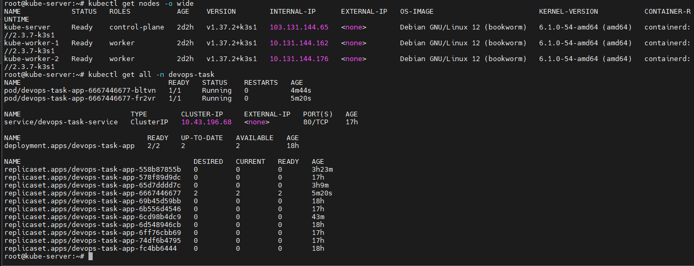
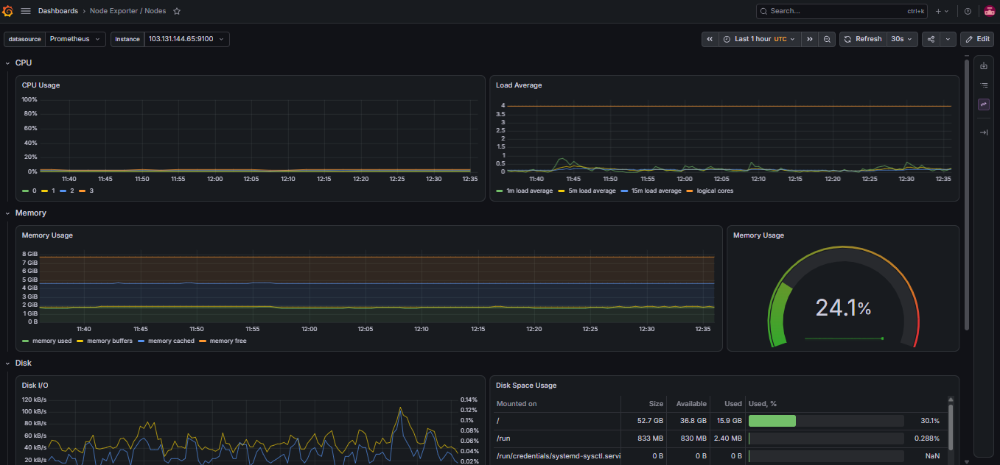
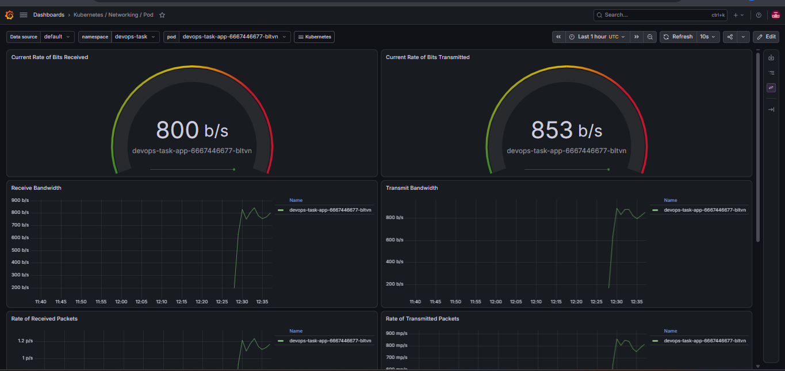
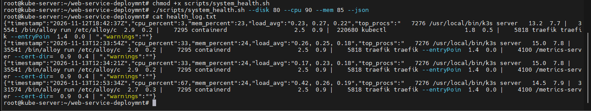

# Web Service Deployment - DevOps Assessment

This repository contains the complete end-to-end deployment of a Node.js web application. The project is structured exactly according to the assessment guidelines, covering containerization, CI/CD, Kubernetes orchestration, observability, and automation.


## Architecture & Network Topology

Instead of relying on a managed cloud service, this project is deployed on a custom-built, bare-metal K3s cluster to demonstrate real-world Kubernetes administration and network routing. 

The cluster consists of 3 nodes (each provisioned with **4 vCPU** and **8GB RAM**). The control plane is exposed via a public IP, while the worker nodes communicate securely over a private network interface.

| Node Name | Role | Interface | IP Address (Node-IP) | OS Version |
| :--- | :--- | :--- | :--- | :--- |
| `kube-server` | Control Plane | `ens11` | `103.131.144.65` (Public) | Debian 12 |
| `kube-worker-1` | Worker/Agent | `ens3` | `10.131.144.162` (Private) | Debian 12 |
| `kube-worker-2` | Worker/Agent | `ens3` | `10.131.144.176` (Private) | Debian 12 |


---

## Step 1: Application & Containerization

The core application is a Node.js web service featuring `/`, `/health`, and `/metrics` endpoints.
- **Dockerfile:** Utilizes a multi-stage build starting from `node:20-alpine` to keep the final image size minimal and secure. It runs as a non-root user and includes proper OCI labels.
- **Local Development:** A `docker-compose.yml` is provided in the root directory to run the application and test health checks locally.

---

## Step 2: CI/CD Pipeline (GitHub Actions)

The CI/CD pipeline is fully automated using GitHub Actions.
- **On Pull Request:** Triggers linting for the application code and Dockerfile to ensure code quality before merging.
- **On Push to Main:** 
  1. Builds a multi-architecture Docker image (`linux/amd64` and `linux/arm64`) with layer caching.
  2. Tags the image with the Git commit SHA and pushes it to GitHub Container Registry (GHCR).
  3. Authenticates with the production K3s server via SSH and triggers a zero-downtime rolling update.

---

## Step 3: Infrastructure as Code (Terraform)

To demonstrate real-world, self-hosted cluster management, this project is currently deployed on a bare-metal Ubuntu K3s VPS instead of a managed cloud service. 

However, to fulfill the Infrastructure as Code requirement, complete Terraform configurations are provided in the `/terraform` directory. This code provisions the necessary AWS EC2 instance, Security Groups, and IAM instance profiles required to run this stack on AWS.

---

## Step 4: Kubernetes Deployment

The application is deployed on a highly available K3s cluster. All Kubernetes manifests are located in the `/k8s` directory.
- **Workload:** A Deployment running 2 replicas with a rolling update strategy.
- **Configuration:** Environment variables are securely injected using `ConfigMap` and `Secret`.
- **Scaling:** A Horizontal Pod Autoscaler (HPA) is configured to scale based on CPU usage.
- **Routing:** External traffic is routed through a Traefik Ingress controller mapped to `devops-task.velmorabeauty-bd.com`.

---

## Step 5: Observability Stack (Bonus Implemented)

I deployed the full monitoring stack directly into the Kubernetes cluster using Helm charts, satisfying the bonus requirement.

**1. Install Prometheus Stack & Grafana (Exposed on NodePort 31204):**
```bash
kubectl create namespace monitoring

helm repo add prometheus-community [https://prometheus-community.github.io/helm-charts](https://prometheus-community.github.io/helm-charts)
helm repo add grafana [https://grafana.github.io/helm-charts](https://grafana.github.io/helm-charts)
helm repo update

helm install kps prometheus-community/kube-prometheus-stack \
  --namespace monitoring \
  --set kubeControllerManager.enabled=false \
  --set kubeEtcd.enabled=false \
  --set kubeScheduler.enabled=false \
  --set prometheus.prometheusSpec.serviceMonitorSelectorNilUsesHelmValues=false \
  --set grafana.adminPassword="YourSecurePassword" \
  --set grafana.service.type=NodePort \
  --set grafana.service.nodePort=31204

```

**2. Install Loki (Single Binary Mode):**

```bash
helm install loki grafana/loki \
  --namespace monitoring \
  --set deploymentMode=SingleBinary \
  --set loki.auth_enabled=false \
  --set loki.commonConfig.replication_factor=1 \
  --set loki.storage.type=filesystem \
  --set singleBinary.replicas=1 \
  --set read.replicas=0 \
  --set write.replicas=0 \
  --set backend.replicas=0 \
  --set loki.useTestSchema=true

```

**3. Install Grafana Alloy & Apply Configurations:**

```bash
helm install alloy grafana/alloy --namespace monitoring

kubectl apply -f k8s/05-monitor.yaml
kubectl apply -f k8s/06-alloy-config.yaml
kubectl apply -f k8s/07-alerts.yaml

```

**Accessing the Dashboards:**
Navigate to `http://103.131.144.65:31204`. Login with `admin` and configure Loki as a data source using `http://loki-gateway.monitoring.svc.cluster.local/`.

---

## Step 6: Linux Automation Scripting

A production-grade bash script (`scripts/system_health.sh`) is provided to monitor host-level metrics (CPU, RAM, Disk, Load) and track top processes.

**Manual Execution:**

```bash
chmod +x scripts/system_health.sh
./scripts/system_health.sh --cpu 90 --mem 85 --disk 80 --json

```

**Automated Cron Execution:**
To run the script every 5 minutes and rotate logs, add this to `crontab -e`:

```bash
*/5 * * * * /root/web-service-deploymnt/scripts/system_health.sh --disk 80 --cpu 90 --mem 85 >> /var/log/health_cron.log 2>&1

```

---

## Step 7: Documentation & Architecture Details

### Design Decisions & Trade-offs

* **Base Image:** I chose `node:20-alpine` over a standard Debian image to significantly reduce the final image size and limit the security attack surface.


* **Loki Labeling:** Parsed JSON logs to extract only `level` and `request_path` as labels. This keeps label cardinality low to prevent Loki query performance degradation, while still allowing quick filtering of 5xx errors on specific routes.


### Deployment & Rollback Strategy

* **Deployment:** The GitHub Action pipeline automatically builds, tags, and applies the new Kubernetes manifests.


* **Rollback:** The pipeline relies on `kubectl rollout status` with a timeout threshold. If a newly deployed pod fails its `/health` liveness/readiness probes (e.g., app crash), the deployment is marked as failed. The pipeline catches this and instantly executes `kubectl rollout undo deployment/devops-task-app` to revert to the last working state, ensuring zero downtime.


### Security Considerations

* **Secrets Management:** Sensitive keys are managed via Kubernetes `Secret` and passed as environment variables. CI/CD SSH keys are securely stored in GitHub Secrets.


* **Least Privilege:** The Node.js application container runs as a non-root user.


* **Network Isolation:** Internal observability components (Prometheus, Alloy, Loki) communicate securely over the internal Kubernetes network. Only Grafana is exposed via NodePort.


## Project Screenshots

### 1. Kubernetes Cluster Infrastructure


**Host Metrics Dashboard:**


**Container Metrics Dashboard:**


### 2. Application & Automation
**API Health Check:**


**System Health Script Execution:**
